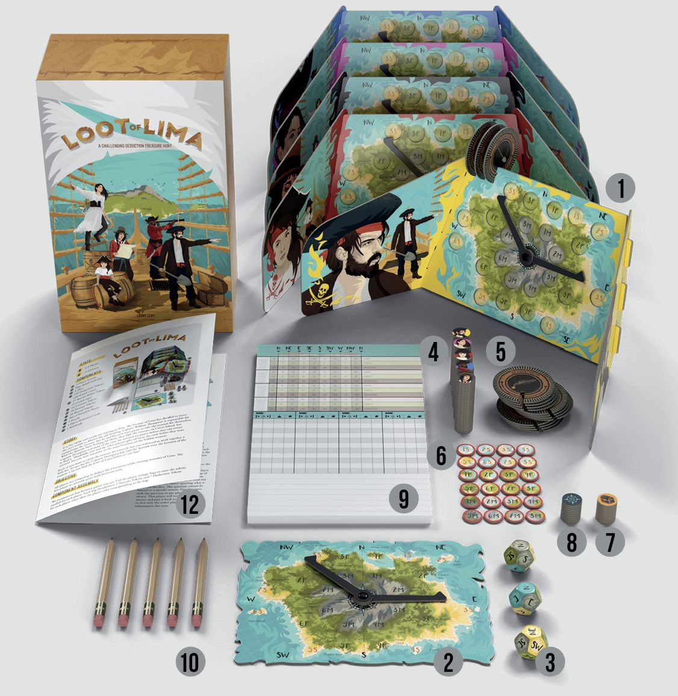
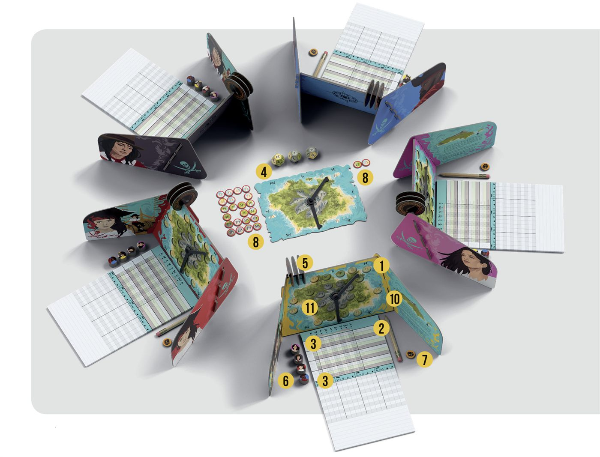
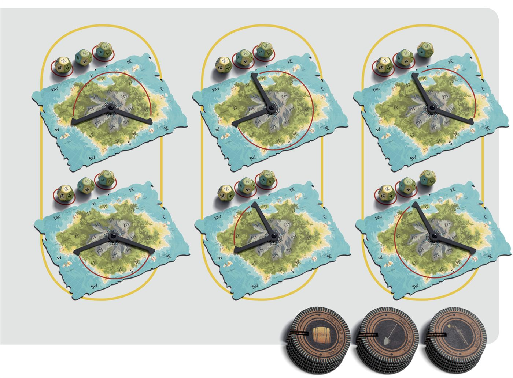
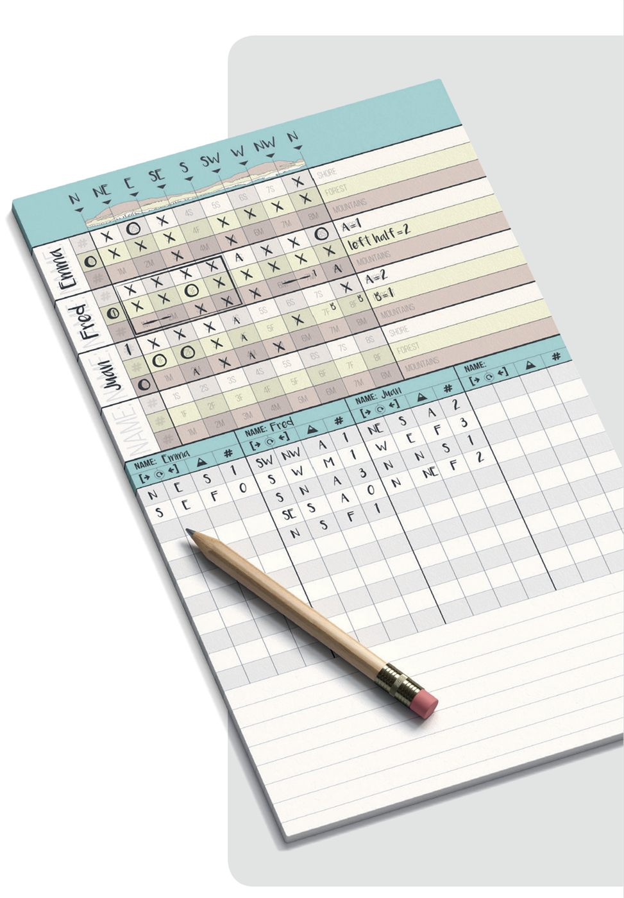

# Loot of Lima

## Stats
- 1-5 Players
- 75 Minutes

## Components
1. 5 Player Screens
2. Map Board with Dial
3. 3 Dice
4. 140 Deduction Tokens (28 of each character)
5. 15 Special Ability Tokens (5 of each type)
6. 24 Location Tokens (20 extra tokens you can write on use of a location token is lost)
7. 10 Treasure Tokens
8. 10 Record Tokens
9. Notes Sheets
10. 5 Pencils
11. 7 Bags and Packing Lists
12. 1 Rulebook
13. 6 Rivets

## Story
Loot of Lima is based on a true story from the 1820s. Revolts are starting in Peru. The Viceroy of Lima has decided to move the city's wealth to Mexico for safekeeping. Captain William Thompson is responsible for transporting the treasure, but he and his crew turn pirate to take the treasure for themselves.

With the Spanish Navy looking for them, they hide the treasure on Cocos Island, but Captain Thompson and most of the crew are arrested for piracy before they can return. Officially, it has never been found.

You and the other players take the role of fictional pirates split off from the crew before they were arrested. However you were not privy to the exact locations of the hidden treasure.

Each of you want to claim the treasure for yourself, but you will need to work together a little bit. To save his life, Captain Thompson has told the Spanish Navy the location of the treasure.

Can you find the Loot of Lima before it's too late?

## Objective
All players are competing to deduce the two locations of the missing treasures of Lima. The first player to correctly guess both locations wins.

## Setup
1. Each player takes:
    - Player Screen
    - Notes Sheet
    - Pencil
2. The contents of their bag:
    - 3 Special Ability Tokens (1 of each type)
    - 7 Deduction Tokens of each other player
    - 2 Treasure Tokens
    - 2 Record Tokens
3. Write down the names of each other player in both sections of your Notes Sheet
4. Place the Map Board and the 3 dice in the middle of the table
5. Shuffle all the numbered Location Tokens facedown, and set two aside without looking at them. Those are the locations of the missing treasure.
6. Deal out all the remaining facedown Location Tokens equally to each player.
7. Any leftover tokens are turned face up in the middle of the table for everyone to see.
8. Without showing the other players, each player looks at their Location Tokens, and slots the tokens into the corresponding locations on their map with the number side hidden. This represents their starting knowledge of where they have already searched and not found the treasure.
9. The player who most recently dug something up goes first.

*We recommend that between games, players store the tokens as instructed on the Packing Lists.*

## Pregame
### Passing
- **3-player games:** Don't pass any tokens.
- **4-player games:** Each player passes one of their Location Tokens to the player across from them.
- **5-player games:** Each player passes one of their Location Tokens to each of the players beside them.

*Players keep the tokens passed to them, placing them in the map on their corresponding locations. Remember to record on your map and Notes Sheet the new token you received and who now has the token you passed.*

### Terrain Announcement
In turn order, each player announces the terrain type where they have the fewest Location Tokens. If a player does not have any tokens of a terrain, then that is the terrain they have the least of. If there is a tie, the player chooses which type to announce, without revealing that there is a tie.

*Example: Player has 3 Beach, 1 Forest and 1 Mountain Tokens. Player may choose to announce 'Forest' or 'Mountain'.*

## Game Play
The game is played in a series of turns beginning with the starting player and continuing clockwise around the table until the game ends.

Each turn you will ask another player how many Location Tokens they have in a certain region. They *must* answer truthfully, for all players to hear. They should set the dials on their personal map to match the question asked and double check their answer because an inaccurate answer will ruin the game.

### Constructing a Question
1. Roll the 3 dice.
2. Choose a player to ask.
3. Choose the two dice to use.
4. Choose which way to face the arrows, and set them on the map.

If the two dice show the same terrain, then the question must only ask about Location Tokens in that terrain. If the two dice show different terrain, then the question is about all terrain. The blue sides of the dice are wild. The player may coose to act as if they are the color of their choice.

Voice the question in form, "How many Location Tokens do you have in \<terrain name\> between \<direction 1\> and \<direction 2\>".

*Example: "How many Location Tokens do you have in the **forest** between the **West** and the **North**?" -or- "How many Location Tokens do you have in **all terrains** between the **Southeast** and the **West**?"*

You should always say (and record on your Notes Sheet) the name of the location with the clockwise pointing arrow first. Note that asking "between the North and West" is different than asking "between the West and North".

Note that you are allowed to have the same direction for both the start and end (if the dice allow it), but this is only useful if you are asking about a specific terrain.

### Special Abilities
Each player begins the game with 3 Special Ability Tokens, which they can spend while constructing their question on their turn. Each of these are once per game abilities. Remove the corresponding Token from your Player Screen when you use the ability.

>**BARREL**: 
  Reroll any number of dice.

>**SHOVEL**: 
  Treat a rolled die as though it were the terrain of your choice.

>**PISTOL**: 
  Ask a secret question to another player instead of using the dice you rolled. Fill in the secret question section of your Notes Sheet, then tear it off and hand it to an opponent.    
  You are not restricted to the dice you roll, but can ask any question that is theoretically legal if you got the correct dice roll. You cannot ask questions that would not normally be allowed. For example, you cannot ask how many mountains and forests they have in a region.  
  The answering player records their answer and hands the paper back to you in secret.

## Notation and Tracking
The top section of your Notes Sheet is arranged by player and possible locations of the treasure on the island. Make marks in this section as you are able to make deductions. For each opponent, mark of the Location Tokanes **you have** and the ones **turned face up in the middle of the table**, since you know they can't have them also. It is also helpful to mark ranges and take other notes on this grid.

The middle section of your Notes Sheet is arranged by player and question, with each opponent getting their own column. You should **record every question** asked of another player and every answer given, regardless of if it is your turn or not, and regardless of if you think it is helpful at the time. Recording the raw questions and answers here will help you fix any mistake in logic you might make later.

When you figure out which Location Tokens a player has, put their token on the map on your Player Screen and mark off that location for all the other players. If you determine that no players have a certain Location Token, then put one of your treasure tokens in that spot.

It sounds obvious, but remember that there are two tokens set aside. When you determine that all players but one don't have a certain location, you cannot deduce that the remaining player has that token because it is possible that no players have that token (and it is the location of a treasure).

## End of Game and Victory
At any point in the game, even if it is not their turn, a player may announce that they think they know where the two treasures are. That player places their Treasure Tokens into the two slots on their Player Screen's map where they believe the treasures are.

That player then secretly looks at the two set aside Location Tokens. If they are correct, they show the Location Tokens and their Player Screen to all the other players to verify. The game is over and they have won!

If they are incorrect, they announce that they are wrong, and leave the Location Tokens set aside facedown without revealing any information. That player is eliminated from being able to win the game, and will not take any more turns. However, they must keep playing to answer questions asked to them by other players.

If all but 1 player is eliminated, the game ends, and the remaining player is the winner.

## Dials Assembly
The first time you setup the game you will need to assemble the dials in the middle of the Player Screens and the central Map Board. The arrows on the dial should be assembled so they point at each other.

## Credits
Design: *Larry Levy*

Development: *John Brieger, Michael Dunsmore, Chad DeShon*

Art: *Daniel Profiri, Anca Gavril*

>Download more Notes Sheets: *bgt.life/lolnotes*  
  Rule clarifications: *bgt.life/lolrules*
